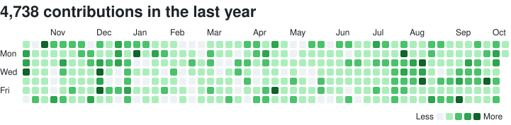

# Hi, I'm Stoupy51 👋

I make Minecraft datapacks and the Python tools that build them.

<picture>
  <source media="(prefers-color-scheme: dark)" srcset="profile/calendar-dark.svg">
  
</picture>

 

- 🍲 [StewBeet](https://stewbeet.paralya.fr/) is a [beet](https://github.com/mcbeet/beet) framework for datapacks: you describe the content once, and models, recipes, loot tables, translations and an in-game manual are built from it.
- 🧰 [stouputils](https://stoupy51.github.io/stouputils/) is the utility library behind all my Python projects.
- ✨ [Stardust Fragment](https://github.com/Stoupy51/StardustFragment) and [SimplEnergy](https://github.com/Stoupy51/SimplEnergy) are my largest datapacks.
- 🏰 I am the main developer of the [Paralya](https://github.com/Paralya) Minecraft server.

## Projects

Hover a project for its description. The tables below are rebuilt every day by [generate_readme.py](generate_readme.py).

<!-- projects:start -->

### 🐍 Python packages

| Project | PyPI | Python | Monthly downloads | Stars | Last commit |
| :-- | :-- | :-- | :-- | :-- | :-- |
| [StewBeet](https://github.com/Stoupy51/StewBeet "A beet framework for generating Minecraft datapacks: declare an item once, and its models, recipes, loot tables, translations and in-game manual page are written on every build.") |  |  |  |  |  |
| [stouputils](https://github.com/Stoupy51/stouputils "Stouputils is a collection of utility modules designed to simplify and enhance the development process. It includes a range of tools for tasks such as execution of doctests, display utilities, decorators, as well as context managers.") |  |  |  |  |  |
| [ClaudeTan](https://github.com/Stoupy51/ClaudeTan "Voice-driven Claude Code assistant with an anime avatar overlay") |  |  |  |  |  |
| [python_datapack](https://github.com/Stoupy51/python_datapack "Python library to help generating advanced Minecraft datapack contents") archived |  |  |  |  |  |

### ⛏️ Minecraft datapacks

| Project | Release | Stars | Modrinth | Smithed | PMC | Last commit |
| :-- | :-- | :-- | :-- | :-- | :-- | :-- |
| [SimplEnergy](https://github.com/Stoupy51/SimplEnergy "SimplEnergy is a simple Energy Datapack created to add simples energy mechanics in your survival world. It is also created to help the development of Energy Datapacks, it was made as a template for whoever wants to create its own") |  |  |  |  |  |  |
| [StardustFragment](https://github.com/Stoupy51/StardustFragment "Stardust Fragment is a very advanced Adventure & Technology Minecraft data pack created to add a very special experience to the game.") |  |  |  |  |  |  |
| [LifeSteal](https://github.com/Stoupy51/LifeSteal "Life Steal FR is a simple datapack aiming to add life steal behaviours from the original Lifesteal SMP. This datapack adds texture for the revive beacon and use 1.21 food components for interactions with the system (eating a heart, consuming a renamed revi") |  |  |  |  |  |  |
| [Survisland](https://github.com/Stoupy51/Survisland) |  |  |  |  |  |  |
| [Paralya/Switch](https://github.com/Paralya/Switch "Data pack gérant le serveur switch de Paralya V2") |  |  |  |  |  |  |
| [CauldronConcretePowder](https://github.com/Stoupy51/CauldronConcretePowder "CauldronConcretePowder is a simple Datapack created to add to possibility for players to drop concrete powders directly in water cauldrons to transform them.") |  |  |  |  |  |  |
| [SmartOreGeneration](https://github.com/Stoupy51/SmartOreGeneration "Minecraft Data pack Library for handling custom ore generation. ") |  |  |  |  |  |  |
| [MC_Guns_System](https://github.com/Stoupy51/MC_Guns_System "Meow meow wouf wouf") |  |  |  |  |  |  |
| [FurnaceNbtRecipes](https://github.com/Stoupy51/FurnaceNbtRecipes "Minecraft datapack library for handling custom furnace recipes with advanced NBT / component support!") |  |  |  |  |  |  |
| [RandomMobSizes](https://github.com/Stoupy51/RandomMobSizes "Minecraft datapack that modifies mob scales randomly between a minimum and maximum value") |  |  |  |  |  |  |
| [RegionsToStructures](https://github.com/Stoupy51/RegionsToStructures "Python script that generates a datapack to place structures in a world depending on source region files") |  |  |  |  |  |  |
| [TheFrostiaDimension](https://github.com/Stoupy51/TheFrostiaDimension "Minecraft Datapack made for a JAM on December 2022 with theme 'Blizzard'") |  |  |  |  |  |  |
| [GolfBall](https://github.com/Stoupy51/GolfBall "Minecraft datapack that handles a golf ball, its inputs and physics.") |  |  |  |  |  |  |
| [CommonSignals](https://github.com/Stoupy51/CommonSignals "Minecraft datapack aiming to make in common several selectors to improve optimisations") |  |  |  |  |  |  |
| [ImagineYourCraftDatapack](https://github.com/Stoupy51/ImagineYourCraftDatapack "Advanced minecraft datapack attempt to recreate ImagineYourCraft's mod") |  |  |  |  |  |  |
| [Cinemalya](https://github.com/Stoupy51/Cinemalya "A datapack library for cinematic/cutscenes in Minecraft") |  |  |  |  |  |  |
| [RealisticExplosion](https://github.com/Stoupy51/RealisticExplosion "Minecraft Datapack Library for handling realistic explosions in an optimized and general way") |  |  |  |  |  |  |
| [SmithedSummit2026](https://github.com/Stoupy51/SmithedSummit2026 "Minecraft datapack made only for Smithed Summit 2026") |  |  |  |  |  |  |
| [SmithedDirect](https://github.com/Stoupy51/SmithedDirect "Smithed Direct 2025 datapack used for video") |  |  |  |  |  |  |
| [SmithedSummit](https://github.com/Stoupy51/SmithedSummit "Minecraft datapack made only for Smithed Summit 2024") |  |  |  |  |  |  |
| [Paralya/Lobby](https://github.com/Paralya/Lobby "Paralya's Lobby data packs folder") |  |  |  |  |  |  |
| [Paralya/Lightium](https://github.com/Paralya/Lightium "Paralya's Faction data packs folder ") |  |  |  |  |  |  |
| [ShoppingKart](https://github.com/Stoupy51/ShoppingKart "Minecraft datapack that handles a kart, its inputs and physics.") |  |  |  |  |  |  |
| [SheepWars](https://github.com/Stoupy51/SheepWars "Minecraft datapack that adds sheeps from SheepWars.") |  |  |  |  |  |  |
| [MoreApples](https://github.com/Stoupy51/MoreApples "More Apples is a simple data pack that modifies all leaves loot tables to add twice as many apples as vanilla oak leaves.") |  |  |  |  |  |  |
| [DurabilityMultiplier](https://github.com/Stoupy51/DurabilityMultiplier "Minecraft Data pack Library for handling custom durability on every damageable item (vanilla & custom).") archived |  |  |  |  |  |  |
| [Energy-Datapack-Template](https://github.com/Stoupy51/Energy-Datapack-Template) archived |  |  |  |  |  |  |
| [EnergyFlux](https://github.com/Stoupy51/EnergyFlux "Energy Flux is an Energy Manager to help the development of Energy Datapacks") archived |  |  |  |  |  |  |
| [UniversalManual](https://github.com/Stoupy51/UniversalManual "This Minecraft datapack adds an book named 'Universal Manual' containing all manuals from all projects that are using Python Datapack") archived |  |  |  |  |  |  |

<b>🤝 Contributions</b> (18)

| Project | Stars | Merged PRs |
| :-- | :-- | :-- |
| [MOSEMBIK/DUT-ProjetS4](https://github.com/MOSEMBIK/DUT-ProjetS4 "Projet obligatoire dans le cadre de l'obtention du diplôme de DUT Informatique à l'IUT de Reims. (voir README.md)") |  | [23](https://github.com/MOSEMBIK/DUT-ProjetS4/pulls?q=is%3Apr+is%3Amerged+author%3AStoupy51) |
| [VGreluchon/Crazy-Adventure-Datapack](https://github.com/VGreluchon/Crazy-Adventure-Datapack) |  | [9](https://github.com/VGreluchon/Crazy-Adventure-Datapack/pulls?q=is%3Apr+is%3Amerged+author%3AStoupy51) |
| [ICY105/DatapackEnergy](https://github.com/ICY105/DatapackEnergy "A Minecraft-Datapack library for handling energy systems.") |  | [7](https://github.com/ICY105/DatapackEnergy/pulls?q=is%3Apr+is%3Amerged+author%3AStoupy51) |
| [Smithed-MC/Libraries](https://github.com/Smithed-MC/Libraries "Collection of Libraries") |  | [5](https://github.com/Smithed-MC/Libraries/pulls?q=is%3Apr+is%3Amerged+author%3AStoupy51) |
| [Octanne/ProjetS6](https://github.com/Octanne/ProjetS6) |  | [5](https://github.com/Octanne/ProjetS6/pulls?q=is%3Apr+is%3Amerged+author%3AStoupy51) |
| [Hardel-DW/NeoEnchant](https://github.com/Hardel-DW/NeoEnchant "The official Technical Enchant+ update") |  | [3](https://github.com/Hardel-DW/NeoEnchant/pulls?q=is%3Apr+is%3Amerged+author%3AStoupy51) |
| [edayot/model_resolver](https://github.com/edayot/model_resolver "A beet plugin that can render items, structures even animated ones !") |  | [2](https://github.com/edayot/model_resolver/pulls?q=is%3Apr+is%3Amerged+author%3AStoupy51) |
| [Sdemonthys/McMap_gun](https://github.com/Sdemonthys/McMap_gun "blablabla") |  | [2](https://github.com/Sdemonthys/McMap_gun/pulls?q=is%3Apr+is%3Amerged+author%3AStoupy51) |
| [misode/misode.github.io](https://github.com/misode/misode.github.io "Data Pack Generators and Tools for Minecraft 1.15, 1.16, 1.17, 1.18, 1.19, 1.20, 1.21, 26.1") |  | [1](https://github.com/misode/misode.github.io/pulls?q=is%3Apr+is%3Amerged+author%3AStoupy51) |
| [mcbeet/beet](https://github.com/mcbeet/beet "The Minecraft pack development kit.") |  | [1](https://github.com/mcbeet/beet/pulls?q=is%3Apr+is%3Amerged+author%3AStoupy51) |
| [maybejake/crop-and-kettle](https://github.com/maybejake/crop-and-kettle "A cozy cooking datapack for Minecraft that adds new food, crops and more! Over 100 recipes!") |  | [1](https://github.com/maybejake/crop-and-kettle/pulls?q=is%3Apr+is%3Amerged+author%3AStoupy51) |
| [Frektip/Technical-Enchant-Renewed](https://github.com/Frektip/Technical-Enchant-Renewed "Technical Enchant+ is a Minecraft Datapack for 1.17, 1.18 and 1.19 that add a new enchanting ecosystem with new mechanincs and features.") |  | [1](https://github.com/Frektip/Technical-Enchant-Renewed/pulls?q=is%3Apr+is%3Amerged+author%3AStoupy51) |
| [edayot/ItemIO](https://github.com/edayot/ItemIO "The all in one library to handle item transportation in minecraft datapacks.") |  | [1](https://github.com/edayot/ItemIO/pulls?q=is%3Apr+is%3Amerged+author%3AStoupy51) |
| [LTHCTheMaster/Magical-Elementalization](https://github.com/LTHCTheMaster/Magical-Elementalization "A Minecraft magic datapack") |  | [1](https://github.com/LTHCTheMaster/Magical-Elementalization/pulls?q=is%3Apr+is%3Amerged+author%3AStoupy51) |
| [Smithed-MC/smithed-python](https://github.com/Smithed-MC/smithed-python "The python package for Smithed. Including weld, cli, and libraries.") |  | [1](https://github.com/Smithed-MC/smithed-python/pulls?q=is%3Apr+is%3Amerged+author%3AStoupy51) |
| [Silabear/Realistic-Item-Drops](https://github.com/Silabear/Realistic-Item-Drops "A simple datapack which makes items display nicely on the floor") |  | [1](https://github.com/Silabear/Realistic-Item-Drops/pulls?q=is%3Apr+is%3Amerged+author%3AStoupy51) |
| [edayot/grappling_hook](https://github.com/edayot/grappling_hook "A simple grappling hook datapack") |  | [1](https://github.com/edayot/grappling_hook/pulls?q=is%3Apr+is%3Amerged+author%3AStoupy51) |
| [Enchanted-Book/Knowledge-Book](https://github.com/Enchanted-Book/Knowledge-Book) |  | [1](https://github.com/Enchanted-Book/Knowledge-Book/pulls?q=is%3Apr+is%3Amerged+author%3AStoupy51) |

<b>🧰 Other projects</b> (4)

| Project | Language | Release | Stars | Last commit |
| :-- | :-- | :-- | :-- | :-- |
| [LearningCProgramming](https://github.com/Stoupy51/LearningCProgramming) | C |  |  |  |
| [MachineLearningFromScratch](https://github.com/Stoupy51/MachineLearningFromScratch "Attempt to create a Machine Learning system that can be used (From scratch)") | C |  |  |  |
| [Paralya/SiteWeb](https://github.com/Paralya/SiteWeb "Site web de Paralya V2") | HTML |  |  |  |
| [AutoReport](https://github.com/Stoupy51/AutoReport "AutoReport is a Python program aiming to automatically make reports by recording audio.") archived | Python |  |  |  |

<b>🎓 School and university</b> (4)

| Project | Language | Release | Stars | Last commit |
| :-- | :-- | :-- | :-- | :-- |
| [SportSocialNetwork](https://github.com/Stoupy51/SportSocialNetwork "Réseau Social basé sur le sport afin de réunir sportifs et coachs autour d'un site. Il a été crée dans le cadre du Projet S3 de ma formation en DUT Informatique ") | PHP |  |  |  |
| [JeFilmeLeMetierQuiMePlait](https://github.com/Stoupy51/JeFilmeLeMetierQuiMePlait "Site Internet basé sur le métier de Game Designer avec une interview avec un étudiant dans le milieu. Il a été crée dans le cadre du Projet S1 de ma formation en DUT Informatique.") | HTML |  |  |  |
| [QuizCulture](https://github.com/Stoupy51/QuizCulture "Site Internet basé sur des Questions que les utilisateurs peuvent proposer. Il a été crée dans le cadre du Projet S2 de ma formation en DUT Informatique") | PHP |  |  |  |
| [INFO0909_SMA](https://github.com/Stoupy51/INFO0909_SMA "University course for Multi Agents System") | Python |  |  |  |

<b>🗃️ Smaller things, without stars or releases</b> (28)

| Project | Category | Language | Description |
| :-- | :-- | :-- | :-- |
| [TribeCivilization](https://github.com/Stoupy51/TribeCivilization "Il existe 4 tribus. Vous arrivez dans un monde dangereux, qui le devient de plus en plus avec le temps où vous découvrirez des structures d'une ancienne civilisation, les Nébuliens. Votre objectif, sur le papier, comprendre ce qui s'est passé et sauver le monde grâce aux différentes structures et récits que vous allez trouver.") | ⛏️ Minecraft datapacks | mcfunction | Il existe 4 tribus. Vous arrivez dans un monde dangereux, qui le devient de plus en plus avec le temps où vous découvrirez des structures d'une ancienne civilisation, les Nébuliens. Votre objectif, sur le papier, comprendre ce qui s'est passé et sauver le monde grâce aux différentes structures et récits que vous allez trouver. |
| [DynamicBookBreakdown](https://github.com/Stoupy51/DynamicBookBreakdown) | ⛏️ Minecraft datapacks | mcfunction |  |
| [Zonweeb](https://github.com/Stoupy51/Zonweeb "Zonweeb (from 2020)") | ⛏️ Minecraft datapacks | mcfunction | Zonweeb (from 2020) |
| [JustNoobLobby](https://github.com/Stoupy51/JustNoobLobby "Lobby datapack for JustNoob Minecraft server") | ⛏️ Minecraft datapacks | mcfunction | Lobby datapack for JustNoob Minecraft server |
| [redemoles-uhc](https://github.com/Stoupy51/redemoles-uhc) | ⛏️ Minecraft datapacks | mcfunction |  |
| [McBingoGenerator](https://github.com/Stoupy51/McBingoGenerator "Datapack generator for a bingo using advancements in Minecraft") | ⛏️ Minecraft datapacks | Python | Datapack generator for a bingo using advancements in Minecraft |
| [Paralya/ParalyaUHC](https://github.com/Paralya/ParalyaUHC "Repository contenant les différents UHC spéciaux de Paralya V2") | ⛏️ Minecraft datapacks | mcfunction | Repository contenant les différents UHC spéciaux de Paralya V2 |
| [PHP-MultiPart-Upload](https://github.com/Stoupy51/PHP-MultiPart-Upload "Unsecured PHP script that allows to upload big files faster on a server by splitting the file and send them through HTTP protocol") | 🧰 Other projects | PHP | Unsecured PHP script that allows to upload big files faster on a server by splitting the file and send them through HTTP protocol |
| [VideoUpscaler](https://github.com/Stoupy51/VideoUpscaler "Simple Python program to upscale a video using 'waifu2x-ncnn-vulkan'") | 🧰 Other projects | Python | Simple Python program to upscale a video using 'waifu2x-ncnn-vulkan' |
| [Survisland-Resources](https://github.com/Stoupy51/Survisland-Resources "Ressources des événements Survisland organisé par la communauté JustNoob sur Minecraft") | 🧰 Other projects | Shell | Ressources des événements Survisland organisé par la communauté JustNoob sur Minecraft |
| [RemoteFolderSync](https://github.com/Stoupy51/RemoteFolderSync "Project attempt to create an efficient remote folder synchronization using C. [Windows / Linux]") | 🧰 Other projects | C | Project attempt to create an efficient remote folder synchronization using C. [Windows / Linux] |
| [c-c---comments-for-c](https://github.com/Stoupy51/c-c---comments-for-c) | 🧰 Other projects |  |  |
| [Paralya/Ressources](https://github.com/Paralya/Ressources "Ressources pour Paralya V2") | 🧰 Other projects |  | Ressources pour Paralya V2 |
| [TER_M2](https://github.com/Stoupy51/TER_M2) | 🎓 School and university | Python |  |
| [INFO0901_GenerativeAI](https://github.com/Stoupy51/INFO0901_GenerativeAI) | 🎓 School and university | Python |  |
| [INFO0808-Visualisation](https://github.com/Stoupy51/INFO0808-Visualisation) | 🎓 School and university | R |  |
| [INFO0705-Analyse](https://github.com/Stoupy51/INFO0705-Analyse) | 🎓 School and university | R |  |
| [INFO0908_OpenData](https://github.com/Stoupy51/INFO0908_OpenData "University project during 5th year, about open data") | 🎓 School and university | Python | University project during 5th year, about open data |
| [INFO0907_Blockchain](https://github.com/Stoupy51/INFO0907_Blockchain) | 🎓 School and university | Python |  |
| [INFO0911_ImageAnalysis](https://github.com/Stoupy51/INFO0911_ImageAnalysis "University project during 5th year, about image treatments and analysis") | 🎓 School and university | Python | University project during 5th year, about image treatments and analysis |
| [INFO0912_DeepLearning](https://github.com/Stoupy51/INFO0912_DeepLearning) | 🎓 School and university | Jupyter Notebook |  |
| [StageM1Info](https://github.com/Stoupy51/StageM1Info) | 🎓 School and university | Python |  |
| [ProjetINFO0803](https://github.com/Stoupy51/ProjetINFO0803) | 🎓 School and university | Python |  |
| [INFO0804](https://github.com/Stoupy51/INFO0804) | 🎓 School and university | R |  |
| [807-DevOps-TD1](https://github.com/Stoupy51/807-DevOps-TD1) | 🎓 School and university | Python |  |
| [L3InfoCrypto](https://github.com/Stoupy51/L3InfoCrypto) | 🎓 School and university | Python |  |
| [Licence-3-Info](https://github.com/Stoupy51/Licence-3-Info) | 🎓 School and university | C |  |
| [INFO0606-KusoGrue](https://github.com/Stoupy51/INFO0606-KusoGrue) | 🎓 School and university | C# |  |

<!-- projects:end -->

